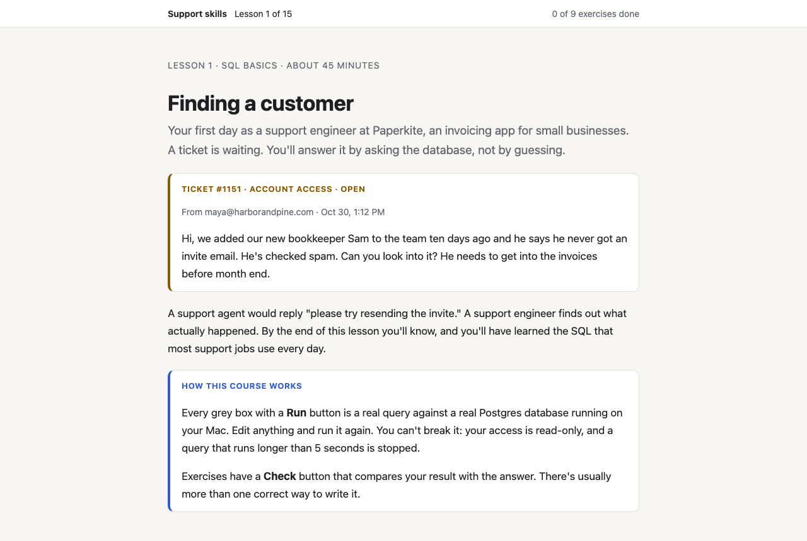
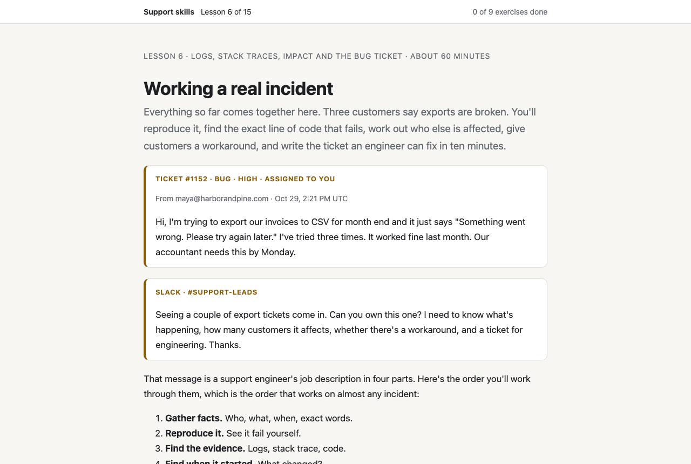

# Support skills

A hands-on course in the technical side of support engineering and CX operations:
SQL, HTML and CSS, HTTP and APIs, working a real incident from ticket to bug report,
and Python scripting with tests.

It's built around **Paperkite**, a made-up invoicing app that runs entirely on your machine:
its own Postgres database, an API you call with curl, JSON logs, and a planted bug.
Every lesson starts with a customer ticket and ends with you answering it.





## Run it

Made for **macOS**. Linux should work with Postgres from your package manager, but it hasn't
been tested; Windows isn't supported.

Use a Node.js LTS release (22.16 or newer), PostgreSQL, and Python 3.11 or newer.
On macOS, install PostgreSQL with `brew install postgresql@16`.

In a terminal, start in any directory where you want to keep the course:

```bash
git clone https://github.com/andrewrdyer1/support-skills.git
cd support-skills
npm ci
npm start
```

Then open http://localhost:4747. The first start creates and seeds the database in `data/`
and downloads the Python dependencies into `.venv`. If startup reports that port `5488`
is in use, free the port and run `npm start` again.

### Or let Claude Code set it up

Clone the repo, open the folder in [Claude Code](https://claude.com/claude-code), and ask:

> Install whatever this course needs and start it.

It checks for Node, Postgres, and Python, installs what's missing (asking first), and runs `npm start`.

| Command | Does |
|---|---|
| `npm start` | start the database (creating it the first time) and the course server |
| `npm stop` | stop the database |
| `npm run reset` | wipe the data and seed it again, exactly as it started |

For the optional `psql` exercises, add the Homebrew binaries to your terminal's PATH if
needed with `export PATH="$(brew --prefix postgresql@16)/bin:$PATH"`. Connect with
`psql "postgresql://learner@localhost:5488/paperkite"` (read-only). Lesson 3's practice
writes use a separate `learner_sandbox` role whose changes can never be committed.

## Lessons

1. **Finding a customer**: select, where, like/ilike, null, order by, joins
2. **Counting things**: aggregates, group by, having, dates and intervals, case, filter
3. **Changing data safely**: insert, update, delete, transactions, and the checklist (practice writes are always rolled back)
4. **What a web page is made of**: HTML, CSS, the box model, flexbox, specificity, DevTools
5. **Talking to an API**: HTTP, status codes, JSON, curl, API keys, pagination, rate limits
6. **Working a real incident**: logs, stack traces, deploy correlation, impact, workarounds, the bug ticket
7. **Python from zero**: where Python runs at work, the terminal and virtual environments, values, variables, numbers, text
8. **Lists, dicts and loops**: collections, for/if/while, nested API data, group-by with a dict, a queue script
9. **Functions and errors**: defining and calling, parameters, return vs print, guards, defaults, one-line if, methods, tracebacks and fixing crashes
10. **Files and your first script**: import and pip, paths, reading files, CSV and JSON, script structure, a first real script, a Jupyter notebook
11. **Python, fast**: the whole language on one page, as a review or the quick route in; adds comprehensions, sorting and try/except
12. **Script: a log triage report**: files, JSON lines, CSV, Counter, first tests with pytest
13. **Script: an API report**: requests, pagination, retries and backoff, env vars, testing with fakes
14. **Script: a safe bulk update**: argparse, dry runs, confirmation, idempotency, partial failure
15. **Script cases**: four take-home style tasks with specs and tests (SQL from Python, logs + DB, data cleaning, alerting)

Lessons 7 to 10 have small scripts and a notebook in `workspace/`; Lessons 12 to 15 are real
projects there, checked with `pytest`.

## Layout

```
server.mjs            the local server: product API + course helpers + lesson pages
src/                  Paperkite's own code (you read this in Lesson 6), incl. the help desk API
course/exercises.mjs  every SQL exercise and its answer
course/py_exercises.mjs  every in-page Python exercise and its hidden tests
course/py_foundations.mjs  the same, for Lessons 7 to 10
course/python.mjs     runs Python from the lesson pages (only this page can call it)
course/solutions/     reference solutions for the workspace projects
workspace/            where you write the Python lessons (see workspace/README.md)
db/schema.sql         the database tables
scripts/seed.mjs      generates all the data, deterministically (today is 2026-10-30)
scripts/db.mjs        runs the course's own Postgres on port 5488, inside data/
public/               the lesson pages and the fake Paperkite web app (portal.html)
```

Run the course on localhost. The in-page Python runner executes your code with the
permissions of the account that started the course.

## License

MIT. Built by [Andy Dyer](https://andyer.com).
